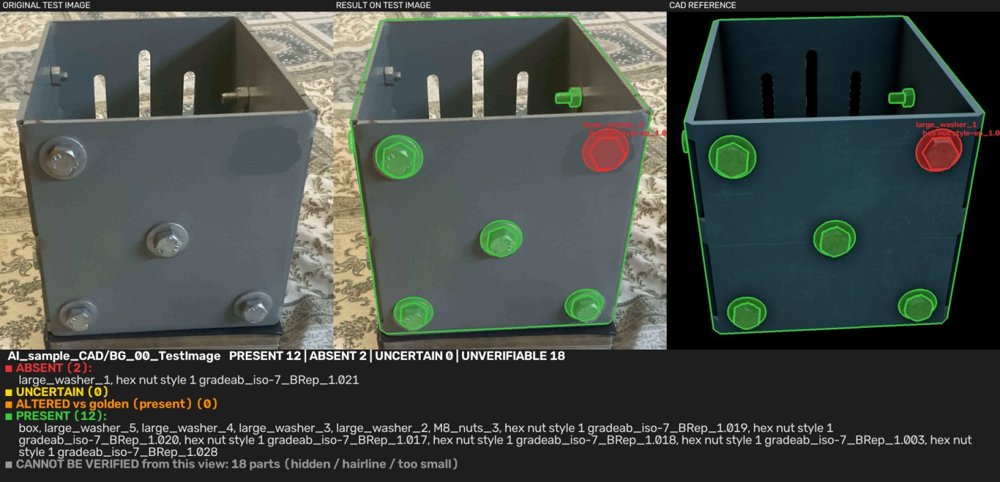

# CAD Part Checker

Compares a **CAD model** with a **photo of the real assembly**, part by part, and tells you which parts are really there.

* **Problem 1 - working code:** foundation-model based presence check (DINOv2 + optional SAM + optional VLM / grounding verifiers such as Qwen2-VL and InternVL3),
  with zero-shot, few-shot and fine-tuning modes. Highlights present / absent parts on the **original test photo** and on the CAD.
* **Problem 2 - architecture:** [`docs/architecture_PS2.md`](docs/architecture_PS2.md) - checking location and dimensions against the CAD.
* **Presentation kit:** Streamlit app, self-contained HTML report, benchmark script, [`docs/PRESENTATION.md`](docs/PRESENTATION.md) (which model to present, demo script, Q&A).



Statuses per part: 🟢 **PRESENT** · 🔴 **ABSENT** · 🟡 **UNCERTAIN** · 🟠 **altered** (present but pixels changed vs a complete photo) · ⚪ **UNVERIFIABLE** (hidden / hairline / too small in the CAD view - never guessed).

## Quick start

| Where | Do this |
|---|---|
| **Kaggle** (2x T4) | upload the project folder (+ data) as a dataset, open `notebooks/kaggle_run.ipynb`, set *GPU* + *Internet ON*, Run all. It finds project and data by itself |
| **Colab** | open `notebooks/colab_run.ipynb`, T4 runtime, edit 3 paths, Run all |
| **Local GPU / CPU** | `pip install -r requirements.txt` -> put data in `data/input/` -> `python run.py check --profile auto --gray --golden auto` |
| **No GPU, no models** | `python run.py check --method classical --golden auto` |
| **Presentation** | `streamlit run app.py` (choose *Browse saved results* for an instant demo) or `python scripts/make_report.py` -> `report.html` |

```bash
pip install -r requirements.txt
python scripts/download_models.py                                   # DINOv2-base (+SAM); one time
python run.py check --profile auto --gray --golden auto            # data/input -> data/output
streamlit run app.py
```

## Layout
```
cad_part_checker/
├── README.md  CHANGELOG.md  requirements*.txt  Makefile  .gitignore  .streamlit/config.toml
├── app.py                      Streamlit app
├── run.py                      CLI: check | train | bank | finetune
├── partcheck/                  data, align, models, features, verifiers, train, pipeline, viz, notebook_utils
├── scripts/                    download_models  check_env  benchmark  make_report  make_synthetic_sample  build_notebooks
├── notebooks/                  kaggle_run.ipynb  colab_run.ipynb
├── examples/                   ground_truth.json  labels_example.json  my_verifier_example.py
├── docs/                       PRESENTATION.md  architecture_PS2.md  COLAB_KAGGLE.md  sample_results/
├── demo/output/                pre-computed results for the app's Browse mode (classical mode, your sample data)
├── data/input/  data/output/   <- your data in, results out
├── models/                     downloaded weights, head.pkl, bank.pkl, dinov2-ft/
└── tests/                      17 tests, no weights needed
```

## Input
Copy your data folder into `data/input/` (any depth). Cases are discovered automatically:
```
AI_sample_CAD/
  FG_00.png                          CAD render                         [FG_* | *CAD* | --cad_glob]
  BG_00.png                          complete real photo (golden)       } every other image = a photo to check
  BG_00_TestImage.png, ...Image2/3   photos to check                    } (or --real_glob 'BG_00_Test*')
  Mask_00_00.bmp                     part-id mask, ids in channel 0     [file named in the json | *mask*]
  0000.json                          {"Mask_00_00.bmp": [{"Name": "...", "StencilValue": 2}, ...]}
  TestCase2/                         another case
```
The original `<p>_Real.jpeg / _CAD.png / _Mask.png / _PartNamesToPixelMap.json` layout and other json shapes (`{"bolt": 5}`, RGB codes) also work. Photo alpha is ignored; images are processed at `--max_side 2048`.
CAD render and photo are assumed to share the camera pose (your data does; `--align ecc` refines slightly).

## Output (`data/output/<case>/<photo>/`)
`result.png` **original test image | result on the test image | CAD reference + status summary** · `detail_2x2.png` (present/absent on CAD and photo) ·
`original.png`, `present_*.png`, `absent_*.png`, `aligned_real.jpg` · `report.json|csv` (status, score, every cue, area, notes) · plus `data/output/summary.csv`.

## Models and modes
Everything is switched by arguments; combine freely. Use the same `--dino --size --gray` when building and using a bank/head.

| Mode | Command | Training | Needs |
|---|---|---|---|
| Classical | `check --method classical` | none | nothing (CPU) |
| **Zero-shot AI** (default) | `check --gray --golden auto` | none | DINOv2 |
| + SAM | `check --sam` | none | SAM |
| + verifiers | `check --vlm internvl3-2b qwen2-vl siglip ...` | none | see table below |
| Few-shot bank | `bank --ref_glob input/BG_00 --labels L.json` -> `check --bank models/bank.pkl` | none | a complete photo |
| Few-shot head | `train --ref_glob ... --labels ...` -> `check --head models/head.pkl` | seconds | same |
| Fine-tune | `finetune --size 518 --steps 300 --ref_glob ... --labels ...` -> `check --dino models/dinov2-ft` | minutes, GPU | same |

**Labels:** only photos matched by `--ref_glob` (pattern on `folder/photo`, e.g. `input/BG_00`) are treated as complete. Real labels go in `--labels` (`examples/labels_example.json`;
keys match as a suffix of `folder/photo`). Everything else falls back to *confident classical predictions*. Never point `--ref_glob` at an edited photo.

### Hardware profiles
`--profile auto` (default) sizes the model to your GPU: `low` = DINOv2-small @518 px (CPU ok) · `balanced` = DINOv2-base @896 px (T4/P100) · `high` = DINOv2-large @1204 px + SAM (>=20 GB).
`--device cuda|mps|cpu`, `--no_fp16`. No GPU? Use Kaggle/Colab ([docs/COLAB_KAGGLE.md](docs/COLAB_KAGGLE.md)).

### Optional VLMs & grounding models (`--vlm`)
| name | model | type | part names? |
|---|---|---|---|
| `clip`, `clip-large` | openai/clip-vit-base-patch32 / large-patch14 | image similarity (+text) | optional |
| `siglip`, `siglip-large` | google/siglip-base-patch16-224 / large-256 | image similarity (+text) | optional |
| `owlv2`, `owlv2-large` | google/owlv2-base-patch16-ensemble | open-vocab detector | **yes** (`--use_names`) |
| `grounding-dino` | IDEA-Research/grounding-dino-tiny | open-vocab detector | **yes** |
| `smolvlm`, `smolvlm-256m` | HuggingFaceTB/SmolVLM-Instruct | chat VLM | optional |
| `qwen2-vl`, `qwen2.5-vl` | Qwen/Qwen2-VL-2B-Instruct, Qwen2.5-VL-3B | chat VLM | optional |
| **`internvl3-1b`, `internvl3-2b`, `internvl3-8b`** | OpenGVLab/InternVL3-*-hf | chat VLM | optional |
| `llava-ov` | llava-hf/llava-onevision-qwen2-0.5b-ov-hf | chat VLM | optional |
| `vlm:<hf id>` | any chat VLM, e.g. `vlm:Qwen/Qwen2-VL-7B-Instruct` | chat VLM | optional |
| `file.py:Class` | your own ([template](examples/my_verifier_example.py)) | anything | - |

`--vlm_uncertain_only` runs them only on borderline parts · `--vlm_weight` (0.3; `1.0` = the verifier decides alone) · `--vlm_4bit` (7-8B on a 16 GB GPU, `pip install -U "bitsandbytes>=0.46.1"`) ·
`--vlm_model clip=openai/clip-vit-large-patch14` swaps a checkpoint · `--trust_remote_code` for repos with custom code. Chat VLMs get *[CAD crop with the part outlined | photo crop]* and a forced A/B question (present / missing).

## Presentation tools
* **Streamlit app** - `streamlit run app.py`: *Analyse a photo* (folder or uploaded files, engine / verifier / threshold controls, part inspector with crops, compare all photos, downloads) and
  *Browse saved results* (instant; ships with `demo/output`). Live from Kaggle/Colab: notebook section 9b.
* **HTML report** - `python scripts/make_report.py --output_dir data/output --out report.html` - one file, images embedded.
* **Benchmark** - `python scripts/benchmark.py --input_dir data/input --truth examples/ground_truth.json` compares configurations (accuracy, recall on absent parts, uncertain, seconds). **Edit `ground_truth.json` first.**
* **Which model to present?** See [docs/PRESENTATION.md](docs/PRESENTATION.md).

## Results on the provided sample
Measured here, classical mode, `--golden auto`, against `examples/ground_truth.json` (my reading of the photos - verify it):
**62 / 64 verifiable parts correct, 0 false alarms, 2 / 4 truly absent parts found.** Found: the removed top-right bolt in `BG_00_TestImage` (washer + nut).
Altered-but-present flagged: `TestImage2` (two parts), `TestImage3` (scribbled nut). **Missed: the two missing bolts in `TestCase2`** (empty holes have edges of their own).
From your Kaggle run (v2.0): DINOv2-base zero-shot matched the classical result, Qwen2-VL-7B-4bit also found the `TestImage` parts, nothing solved `TestCase2`.
The v2.1 fixes (see CHANGELOG) have **not** been re-run on a GPU - run notebook sections 5-8 to refresh the numbers.

## Add your own model
Subclass `Verifier` (`examples/my_verifier_example.py`), implement `score(part_name, region) -> [0,1]`, run `check --vlm path/to/file.py:MyVerifier`.
Different patch backbone: `--dino <hf id or folder>` (any DINOv2-architecture model, incl. `dinov2-reg-*`).

## Tuning / troubleshooting
* Results look wrong -> open `aligned_real.jpg`; the CAD and photo must overlay (otherwise `--align ecc|none`, or the camera pose differs).
* Present flagged absent -> lower `--thr` (0.4) or `--ai_weight`; try `--gray`. Absent flagged present -> raise `--thr`, add a verifier, give `--labels` and `train`.
* Small parts `UNVERIFIABLE` -> raise `--max_side` (3072) / lower `--min_area_px`. Out of memory -> `--profile low`, `--vlm_4bit`, `--vlm_uncertain_only`.
* `AttributeError ... BaseModelOutputWithPooling` / `post_process_object_detection` -> you are on v2.0; update to v2.1.
* Some VLMs need `pip install -r requirements-extras.txt` or a newer `transformers`. Offline machine -> run `scripts/download_models.py` elsewhere and copy `models/`.

## Tests
`python -m pytest -q tests` - 17 tests (~15 s, no weights): folder & prefix layouts, statuses, golden flag, report card contains the original, bank/head, plug-in verifiers, version-proof helpers, the Streamlit app.

## Limitations (please read)
* **Not executed here:** DINOv2, SAM, fine-tuning and the CLIP/OWLv2/Grounding-DINO/VLM/**InternVL** code paths were fixed by reading your logs and the library APIs, **not run** (no GPU / weights in the build sandbox).
  The InternVL3 `-hf` repo ids and the new A/B prompt are untested; use the benchmark to verify them.
* Thresholds were tuned on this one object. Classical cues cannot tell a bolt from an empty hole (`TestCase2`).
* CAD render and photo must share the camera pose. Hidden / hairline / tiny parts are never judged.
* Synthetic "erase" training data is simpler than real missing parts; add real negatives via `--labels`.
* Location / dimension checking is design-only (Problem 2).
